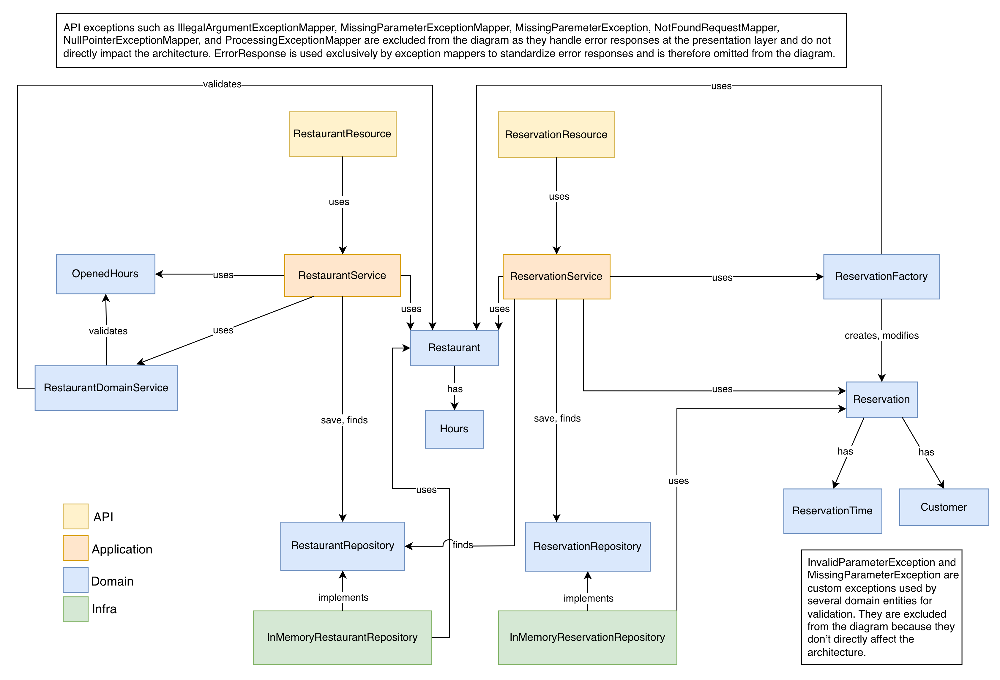

# Exercices - TP2

---

## Déclaration d'utilisation de l'IA

Pour ce projet, certains membres de l'équipe ont utilisé **ChatGPT** d'OpenAI comme outil d'intelligence artificielle.

### Outils utilisés
- ChatGPT pour aider à structurer les étapes d'implémentation.
- ChatGPT pour aider à tester les requêtes.

### Comment nous avons intégré l'IA dans notre travail
- Nous avons demandé à ChatGPT d'aider à subdiviser et structurer les étapes globales du travail.
- Nous avons utilisé ChatGPT pour générer des exemples de commandes `curl` pour tester l'API REST.

### Rôle de l'IA dans la réalisation du projet
- L'IA a servi d'assistant pour organiser le projet en sous-tâches et faciliter la compréhension des interactions avec l'API.
- Elle a facilité la mise en place des tests à l'aide du terminal.
- Elle a fourni des suggestions pour améliorer la clarté du code et la validation des données.

**Nous certifions que le code soumis est le fruit de notre travail personnel, avec l'appui de l'outil mentionné**.

---

## Rétrospective sur le processus

Liste des métriques importantes à mesurer pour démarrer la réflexion :

### Combien de temps votre équipe prenait-elle pour implémenter une issue ?

**Moyenne** : 48 heures
**Minimum** : 24 heures
**Maximum** : 96 heures

### Combien de temps votre équipe prenait-elle pour intégrer une pull-request ? (review + correctifs)

**Moyenne** : 20 heures
**Minimum** : 1 heure
**Maximum** : 48 heures

### Combien de personnes travaillaient sur chaque issue ? (individuel, paire, équipe, etc.)

**Moyenne** : 1
**Minimum** : 1
**Maximum** : 2

### Combien de personnes reviewaient chaque pull-request ?

**Moyenne** : 3
**Minimum** : 1
**Maximum** : 5

### Combien d'issue étaient en cours d'implémentation en même temps

**Moyenne** : 2
**Minimum** : 1
**Maximum** : 3

### Combien de pull-requests étaient en cours de review en même temps ?

**Moyenne** : 2
**Minimum** : 1
**Maximum** : 3

### Selon vous, est-ce que les issues/pull-requests prenaient trop de temps à être terminées? Ou pas assez? Quel serait le temps idéal (approximatif) pour chacun?

Dans l’ensemble, le temps pris pour compléter les issues a été jugé **raisonnable compte tenu du contexte et des contraintes du projet.**
- Pour plusieurs membres, **le temps idéal** pour une issue se situerait **entre 2 et 3 jours**, et **entre 24h et 48h** pour les plus petites.
- Concernant les pull-requests, la majorité s’accorde sur le fait qu’elles ont **souvent pris plus de temps que souhaité**, principalement à cause des **temps d’attente pour les revues et les validations**.
- L’idéal évoqué serait d’avoir des pull-requests validées en **1 à 2 jours**, selon leur complexité et le nombre de retours à traiter.
- Enfin, il a été noté que certaines premières fonctionnalités ont nécessité **plus de temps au démarrage** (mise en place de l’architecture, alignement d’équipe, ajustements initiaux).

### Quel est le lien entre la taille de ces issues/pull-requests et le temps que ça prenait à les terminer?

Deux perspectives ressortent :
- Certains estiment que la **taille des issues et PR** est directement **liée au temps nécessaire** : plus une tâche ou une PR est grande, plus elle demande de temps pour être comprise, développée et relue.
- D’autres jugent que la **taille n’est pas toujours le facteur principal**, soulignant plutôt le rôle du **manque de communication**, **d’organisation**, ou simplement du **manque de disponibilité** de certains membres.
- Tous s’accordent toutefois sur le fait que **des tâches plus petites, mieux définies et bien séparées** favorisent une implémentation et une validation plus rapides.

### Donnez au moins 3 trucs pour améliorer votre processus (tailles des issues/pr, communication, code reviews, uniformisation, etc.)

Plusieurs pistes d’amélioration ont été proposées, souvent complémentaires :
- **Organisation et découpage des tâches**
    - Mieux **découper les issues** pour qu’elles soient plus courtes et ciblées sur une seule fonctionnalité.
    - **Fixer des dates de fin** pour certaines issues afin d’assurer un avancement plus régulier.
    - Encourager des **pull requests plus petites** et bien circonscrites.
- **Communication et synchronisation**
    - Améliorer la **communication sur l’avancement** des travaux et les tâches à venir.
    - Planifier **des créneaux de revue en équipe réguliers** (par exemple, une courte réunion hebdomadaire dédiée aux PR).
    - Maintenir une meilleure **coordination** entre les membres pour éviter les blocages.
- **Code review et uniformisation**
    - Accélérer les **revues de code et validations**, en visant une réactivité plus constante.
    - Avoir **au moins 2 à 3 reviewers par PR** pour garantir la qualité du code.
    - **Documenter les décisions d’architecture** dans un espace partagé afin d’éviter de redébattre des choix techniques.

---

## Captures d'écran

### Screenshot du GitHub Project (colonnes + issues)

### Screenshots du Milestone (titre, description, date, issues)

### Screenshots de 3 issues

#### Issue 1

#### Issue 2

#### Issue 3

### Screenshot de 3 Pull Requests (avec reviews)

#### Pull request 1

#### Pull request 2

#### Pull request 3

### Screenshots de 'arbre de commits et branches (≥10 commits)

---

## Diagramme d'architecture

---
